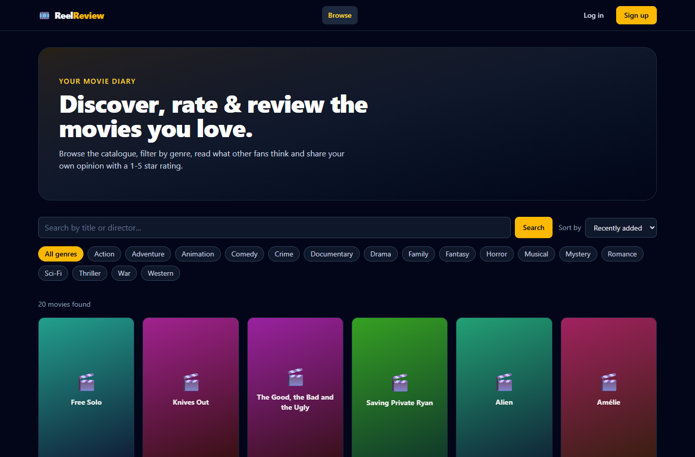
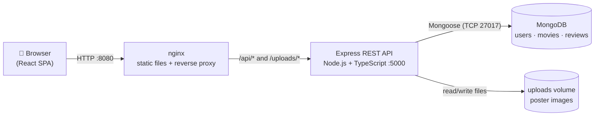
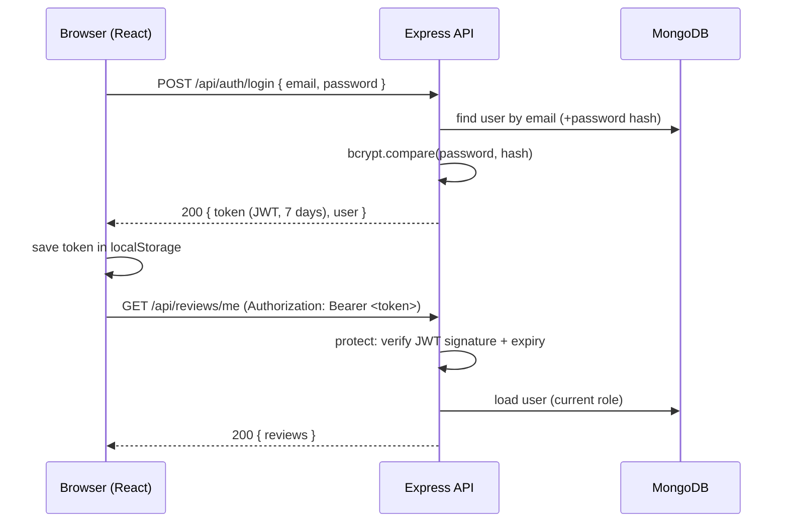
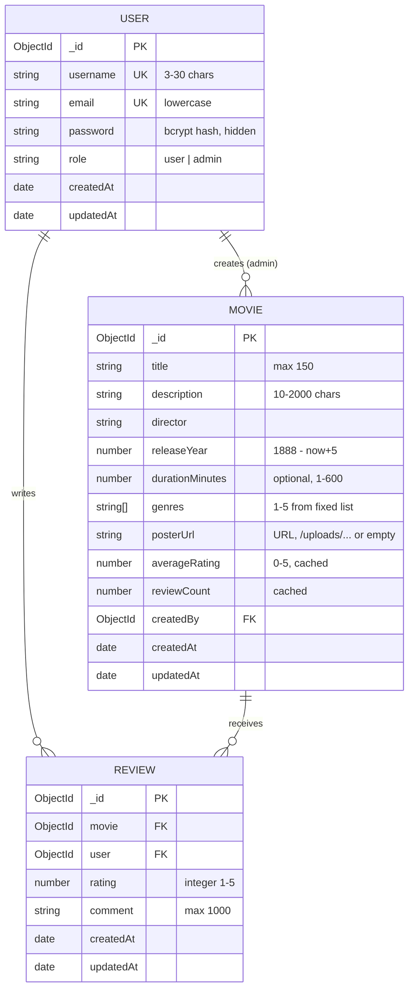
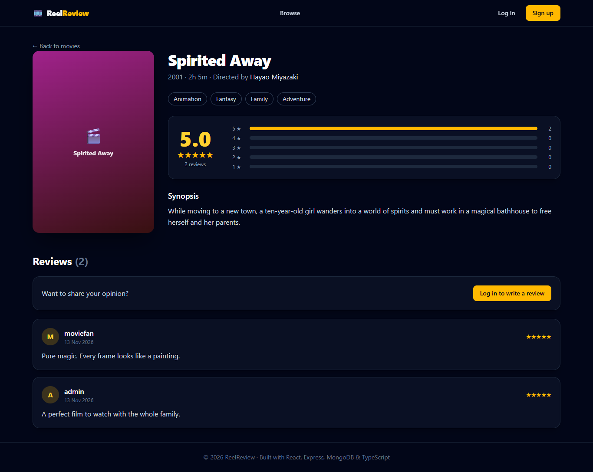
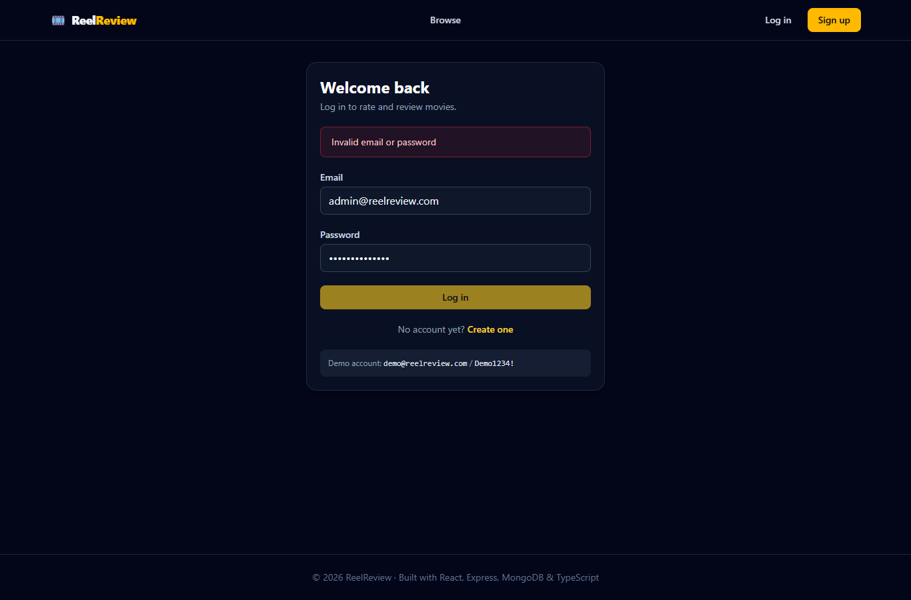
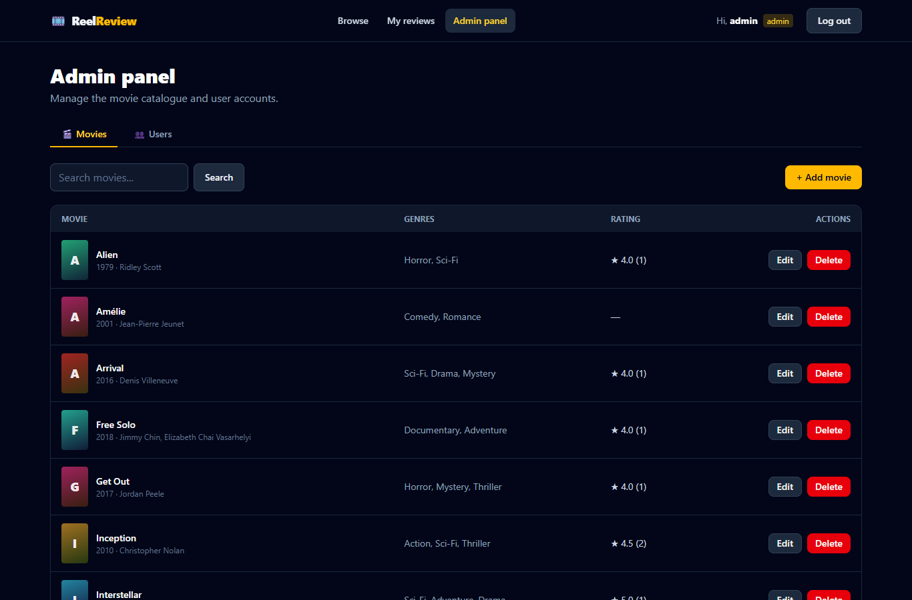
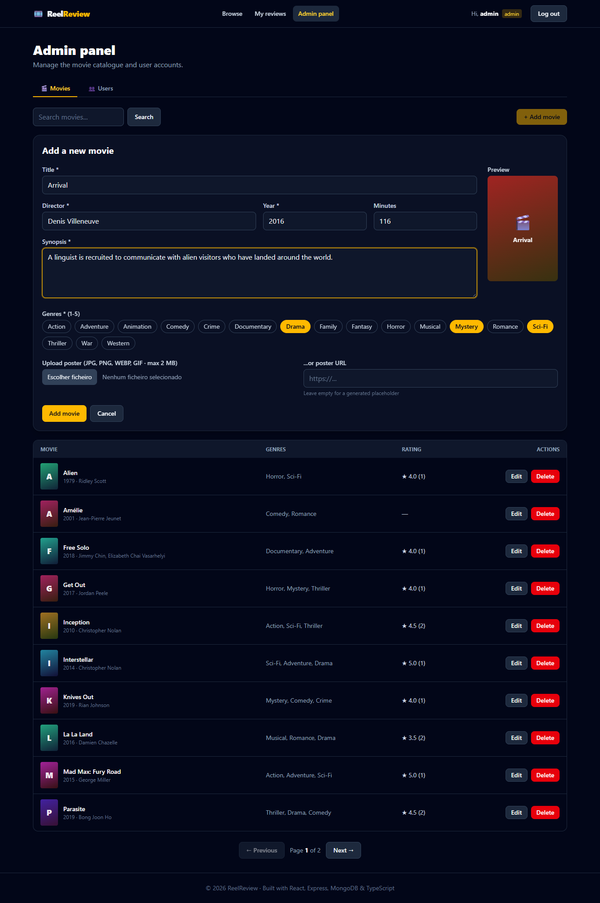
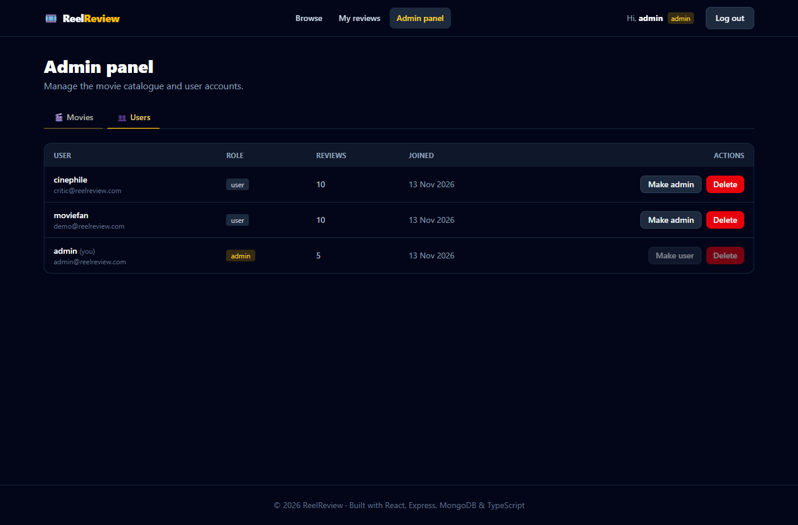
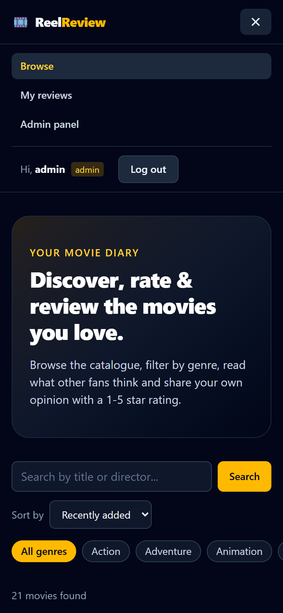

# 🎞️ ReelReview — Movie Browsing, Rating & Review Platform

A full-stack web application where people can **browse movies, search by title/director, filter by genre, rate them with 1–5 stars and write reviews**, with an **admin panel** to manage the catalogue, moderate reviews and manage users.




---

## ⚡ Quick start (TL;DR)

You only need **[Docker Desktop](https://www.docker.com/products/docker-desktop/)** and **[Git](https://git-scm.com/downloads)** installed:

```bash
git clone https://github.com/dinissilvaaa/reelreview.git
cd reelreview
docker compose up --build
```

Open **http://localhost:8080** and log in with a [demo account](#-demo-accounts).
Need step-by-step instructions (installing everything from zero)? Go to **[12. Deployment & Execution](#12-deployment--execution)**.

---

## 📚 Table of contents

1. [Project Title](#1-project-title)
2. [Project Overview](#2-project-overview)
3. [Target Users](#3-target-users)
4. [Core Functionalities](#4-core-functionalities)
5. [Non-Functional Requirements](#5-non-functional-requirements)
6. [Technology Stack](#6-technology-stack)
7. [System Architecture](#7-system-architecture)
8. [Data Model](#8-data-model)
9. [API Scope](#9-api-scope)
10. [Project Management Plan](#10-project-management-plan)
11. [Testing](#11-testing)
12. [Deployment & Execution](#12-deployment--execution) ← **how to install and run**
13. [Final Documentation](#13-final-documentation)

---

## 1. Project Title

**ReelReview — Movie Browsing, Rating & Review Platform**

---

## 2. Project Overview

ReelReview is a single-page web application for discovering movies and sharing opinions about them. Choosing what to watch is hard when information is scattered, so ReelReview gathers a movie catalogue, community ratings and written reviews in one fast, mobile-friendly place. Visitors can browse, search and filter the catalogue by genre and sort it by rating or popularity; registered users can give each movie a 1–5 star rating with a review, and edit or delete it later. Every movie shows its average rating and rating distribution, which are recalculated automatically. Administrators manage the catalogue (including poster uploads), moderate reviews and manage user accounts from a dedicated admin panel.

---

## 3. Target Users

| User type | Description | What they do |
|---|---|---|
| **Visitor** (not logged in) | Anyone deciding what to watch | Browse, search and filter movies, read ratings and reviews |
| **Registered user** | Movie fans, students, film clubs | Everything a visitor can do + rate and review movies, manage their own reviews |
| **Administrator** | Site owner / content moderator | Everything a user can do + add/edit/delete movies, upload posters, delete any review, manage user roles and accounts |

---

## 4. Core Functionalities

Functional requirements, written from the user's perspective. Each one is testable (see [11. Testing](#11-testing)).

| ID | Requirement | Priority |
|---|---|---|
| FR1 | User can **register**, **log in** and **log out** | Must have |
| FR2 | Visitor can **browse** all movies in a paginated, responsive grid | Must have |
| FR3 | Visitor can **search** movies by title or director | Must have |
| FR4 | Visitor can **filter movies by genre** and **sort** them (newest, best rated, most reviewed, year, title) | Must have |
| FR5 | Visitor can open a **movie page** with details, average rating, rating distribution and all reviews | Must have |
| FR6 | Logged-in user can **rate (1–5 stars) and review** a movie (one review per movie) | Must have |
| FR7 | User can **edit and delete their own review** | Must have |
| FR8 | User can see a list of **all their reviews** ("My reviews") | Should have |
| FR9 | Admin can **create, edit and delete movies**, including **uploading a poster image** | Must have |
| FR10 | Admin can **delete any review** (moderation) | Should have |
| FR11 | Admin can **list users, promote/demote admins and delete accounts** | Should have |

---

## 5. Non-Functional Requirements

| ID | Requirement | How it is met |
|---|---|---|
| NFR1 | **Language: TypeScript** (JavaScript superset) | 100% TypeScript in frontend and backend, `strict` mode enabled |
| NFR2 | **Readable & maintainable code** | Layered backend (routes → middleware → controllers → models), reusable React components, one responsibility per file, **every line commented**, linter (oxlint) |
| NFR3 | **User input validation** | Client-side validation with instant feedback **and** server-side validation (`utils/validators.ts`) **and** Mongoose schema validation |
| NFR4 | **Error handling** | `async/await` + `try/catch` in every controller, central error middleware, correct HTTP status codes (200, 201, 400, 401, 403, 404, 409, 413, 429, 500), friendly error messages in the UI, retry buttons |
| NFR5 | **Responsive UI** | Tailwind CSS mobile-first layout, grid from 2 to 6 columns, hamburger menu on phones, tested at 390 px width (no horizontal scroll) |
| NFR6 | **Basic security** | bcrypt password hashing, JWT authentication, role-based authorization, Helmet security headers, CORS whitelist, rate limiting on login/register, NoSQL-injection-safe validation, escaped regex search, upload type/size limits, secrets in `.env` (never committed), non-root Docker user |
| NFR7 | **Docker support** | Multi-stage Dockerfiles for backend and frontend, `docker-compose.yml` runs MongoDB + API + web app with one command |
| NFR8 | **GitHub repository** | Public repo with branches, commits and a project board |
| NFR9 | **Markdown documentation** | This README (13 sections) + Postman collection + screenshots |
| NFR10 | **Performance** | Database indexes (genre, title, rating, unique review per user/movie), pagination (max 50 per page), cached average rating, lazy-loaded images, gzip + long-term caching in nginx |
| NFR11 | **Accessibility** | Semantic HTML, labels for every input, ARIA roles (radiogroup for stars, tabs, alerts), keyboard-accessible star rating, visible focus outlines |

---

## 6. Technology Stack

**Stack 1 — MERN + TypeScript.**

| Layer | Technology | Purpose |
|---|---|---|
| **Frontend** | React 19 + TypeScript | UI components (SPA) |
| | Vite 8 | Dev server and production bundler |
| | Tailwind CSS 4 | Styling / responsive design |
| | React Router 7 | Client-side routing |
| | Axios | HTTP client (with JWT interceptor) |
| **Backend** | Node.js 24 LTS + Express 5 (TypeScript) | REST API |
| | jsonwebtoken (JWT) + bcryptjs | Authentication and password hashing |
| | Multer | Poster image uploads |
| | Helmet, CORS, express-rate-limit, Morgan | Security headers, CORS, brute-force protection, request logging |
| **Database** | MongoDB 8 + Mongoose 9 | Document database + schemas/validation |
| **Testing** | Vitest + Supertest + mongodb-memory-server | Backend unit & integration tests |
| | Vitest + React Testing Library + jsdom | Frontend unit & component tests |
| | Puppeteer (with local Chrome/Edge) | End-to-end smoke test |
| | Postman | Manual API testing (collection included) |
| **DevOps** | Docker, Docker Compose, nginx | Containers, orchestration, static hosting + reverse proxy |
| **Tools** | Git + GitHub, GitHub Projects, VS Code, oxlint, tsx | Version control, Kanban board, editor, linter, TS runner |

---

## 7. System Architecture

### 7.1 Overview



- **Frontend (SPA)** — React renders every page in the browser; React Router changes pages without reloading. All data comes from the API as JSON through Axios.
- **Backend (REST API)** — Express receives HTTP requests, validates them, applies authentication/authorization, runs the business logic and talks to MongoDB through Mongoose.
- **Database** — MongoDB stores three collections: `users`, `movies`, `reviews`.
- **Communication** — JSON over HTTP (REST). Poster uploads use `multipart/form-data`. In development the Vite dev server proxies `/api` to the backend; in Docker nginx does the same, so the browser always talks to **one origin** (no CORS issues).

### 7.2 Backend structure (layers)

```
Request → route → middleware (auth, admin, id check, upload) → controller → model → MongoDB
                                         ↓ errors (next(error))
                                   errorHandler → JSON response with status code
```

```
backend/
├── src/
│   ├── index.ts              # Entry point: connect DB, seed, start server, graceful shutdown
│   ├── app.ts                # Express app: middleware + routes (imported by tests)
│   ├── config/               # env.ts (typed env variables), db.ts (MongoDB connection)
│   ├── constants/            # genres.ts, roles.ts
│   ├── models/               # User.ts, Movie.ts, Review.ts (Mongoose schemas)
│   ├── controllers/          # auth, movie, review, user controllers (business logic)
│   ├── routes/               # authRoutes, movieRoutes, reviewRoutes, userRoutes
│   ├── middleware/           # auth (protect/adminOnly), errorHandler, upload, rateLimiter, validateObjectId
│   ├── utils/                # validators, token (JWT), movieStats (average rating), files, query helpers
│   ├── seed/                 # Demo data + seed script
│   └── types/                # express.d.ts (adds req.user)
├── tests/                    # Vitest + Supertest tests
├── Dockerfile
└── .env.example
```

### 7.3 Frontend structure

```
frontend/
├── src/
│   ├── main.tsx              # Mounts <App/> with Router + AuthProvider
│   ├── App.tsx               # Layout + routes
│   ├── api/                  # Axios client + one file per resource (auth, movies, reviews, users)
│   ├── context/              # AuthContext + AuthProvider (logged-in user, login/logout)
│   ├── hooks/                # useAuth, useDocumentTitle
│   ├── components/           # Navbar, MovieCard, Poster, StarRating, ReviewForm, Pagination, ...
│   │   └── admin/            # MovieForm, AdminMoviesTab, AdminUsersTab
│   ├── pages/                # Home, MovieDetails, Login, Register, MyReviews, Admin, NotFound
│   ├── utils/                # validation.ts, format.ts (+ tests)
│   └── types/                # Shared TypeScript types
├── nginx.conf                # Used by the Docker image
└── Dockerfile
```

**Pages & routes**

| Route | Page | Access |
|---|---|---|
| `/` | Browse, search, filter, sort | Public |
| `/movies/:id` | Movie details + reviews | Public (writing requires login) |
| `/login`, `/register` | Authentication forms | Public |
| `/my-reviews` | My reviews | Logged-in users |
| `/admin` | Admin panel (Movies / Users tabs) | Admins |
| `*` | 404 page | Public |

### 7.4 Authentication & authorization



- **Passwords** are hashed with bcrypt (cost 10) in a Mongoose `pre('save')` hook and never returned by the API.
- **JWT** tokens are signed with `JWT_SECRET` and contain only the user id. Every protected request reloads the user, so role changes and deleted accounts take effect immediately.
- **Authorization**: `protect` (must be logged in) → `adminOnly` (must be admin). Review ownership is checked in the controllers (only the author can edit; author or admin can delete).
- On the frontend, `ProtectedRoute` hides pages from visitors, and an Axios interceptor logs the user out automatically when the token expires (401).

### 7.5 Deployment approach

The application is shipped as **three Docker containers** orchestrated by Docker Compose (see [12](#12-deployment--execution)): `mongo` (database with a persistent volume), `backend` (compiled Node.js API, non-root user, health check) and `frontend` (nginx serving the built SPA and proxying `/api` and `/uploads` to the backend).

---

## 8. Data Model



| Collection | Key fields | Indexes / rules |
|---|---|---|
| `users` | `username`, `email`, `password` (hash), `role` | unique `username`, unique `email`; password `select: false` |
| `movies` | `title`, `description`, `director`, `releaseYear`, `durationMinutes`, `genres[]`, `posterUrl`, `averageRating`, `reviewCount`, `createdBy` | indexes on `genres`, `title`, `averageRating` |
| `reviews` | `movie` → Movie, `user` → User, `rating`, `comment` | **unique (`movie`, `user`)** = one review per user per movie |

**Allowed genres:** Action, Adventure, Animation, Comedy, Crime, Documentary, Drama, Family, Fantasy, Horror, Musical, Mystery, Romance, Sci-Fi, Thriller, War, Western.

`averageRating` and `reviewCount` are **derived data**: after every review create/update/delete, an aggregation pipeline (`$match` → `$group` with `$avg`) recalculates them (`utils/movieStats.ts`). Deleting a movie deletes its reviews; deleting a user deletes their reviews and fixes the affected averages.

---

## 9. API Scope

Base URL: `http://localhost:5000/api` (or `http://localhost:8080/api` through nginx).
Authentication: send `Authorization: Bearer <token>` for 🔒 routes.

| Method | Endpoint | Access | Description | Success | Errors |
|---|---|---|---|---|---|
| GET | `/health` | Public | Health check | 200 | – |
| **Authentication** | | | | | |
| POST | `/auth/register` | Public | Create account → `{ token, user }` | 201 | 400, 409, 429 |
| POST | `/auth/login` | Public | Log in → `{ token, user }` | 200 | 400, 401, 429 |
| GET | `/auth/me` | 🔒 User | Current user | 200 | 401 |
| **Movies (Read + Filtering/Searching)** | | | | | |
| GET | `/movies?search=&genre=&sort=&page=&limit=` | Public | Paginated list. `sort`: `newest` · `rating` · `popular` · `year` · `title` | 200 | 400 |
| GET | `/movies/genres` | Public | Allowed genres | 200 | – |
| GET | `/movies/:id` | Public | One movie | 200 | 400, 404 |
| **Movies (Create / Update / Delete)** | | | | | |
| POST | `/movies` | 🔒 Admin | Create (JSON or `multipart/form-data` with `poster` file) | 201 | 400, 401, 403 |
| PUT | `/movies/:id` | 🔒 Admin | Update (only the fields sent) | 200 | 400, 401, 403, 404 |
| DELETE | `/movies/:id` | 🔒 Admin | Delete movie + its reviews + poster file | 200 | 401, 403, 404 |
| **Reviews** | | | | | |
| GET | `/movies/:movieId/reviews` | Public | Reviews of a movie (newest first) | 200 | 400, 404 |
| POST | `/movies/:movieId/reviews` | 🔒 User | Create review `{ rating, comment }` | 201 | 400, 401, 404, 409 |
| GET | `/reviews/me` | 🔒 User | My reviews | 200 | 401 |
| PUT | `/reviews/:id` | 🔒 Author | Update my review | 200 | 400, 401, 403, 404 |
| DELETE | `/reviews/:id` | 🔒 Author or Admin | Delete review | 200 | 401, 403, 404 |
| **Users (admin panel)** | | | | | |
| GET | `/users` | 🔒 Admin | All users + review counts | 200 | 401, 403 |
| PATCH | `/users/:id/role` | 🔒 Admin | Change role `{ role: "user" \| "admin" }` | 200 | 400, 401, 403, 404 |
| DELETE | `/users/:id` | 🔒 Admin | Delete user + their reviews | 200 | 400, 401, 403, 404 |
| | `/uploads/<file>` | Public | Uploaded poster images (static files) | 200 | 404 |

### Example requests

**Log in**

```http
POST /api/auth/login
Content-Type: application/json

{ "email": "demo@reelreview.com", "password": "Demo1234!" }
```

```json
{
  "token": "eyJhbGciOiJIUzI1NiIsInR5cCI6IkpXVCJ9...",
  "user": { "id": "6af6ea2afce2f62f67d4e16f", "username": "moviefan", "email": "demo@reelreview.com", "role": "user", "createdAt": "2026-11-13T10:44:58.263Z" }
}
```

**Search + filter**

```http
GET /api/movies?search=nolan&genre=Sci-Fi&sort=rating
```

```json
{
  "movies": [
    { "_id": "6af6ea2a...", "title": "Interstellar", "director": "Christopher Nolan", "releaseYear": 2014,
      "durationMinutes": 169, "genres": ["Sci-Fi", "Adventure", "Drama"], "posterUrl": "",
      "averageRating": 5, "reviewCount": 1, "createdAt": "...", "updatedAt": "..." },
    { "_id": "6af6ea2a...", "title": "Inception", "averageRating": 4.5, "reviewCount": 2, "...": "..." }
  ],
  "page": 1, "limit": 12, "total": 2, "totalPages": 1
}
```

**Create a review**

```http
POST /api/movies/6af6ea2a.../reviews
Authorization: Bearer <token>
Content-Type: application/json

{ "rating": 4, "comment": "Mind-bending plot and an incredible soundtrack." }
```

```json
{ "review": { "_id": "...", "movie": "...", "user": { "_id": "...", "username": "moviefan" }, "rating": 4, "comment": "Mind-bending plot and an incredible soundtrack.", "createdAt": "...", "updatedAt": "..." } }
```

**Validation error (400)**

```json
{ "message": "Validation failed", "errors": ["Title is required", "Release year must be a whole number between 1888 and 2031"] }
```

A ready-to-import **Postman collection** with all 33 requests (including error cases and automatic token handling) is in [`docs/ReelReview.postman_collection.json`](docs/ReelReview.postman_collection.json).

---

## 10. Project Management Plan

| Item | Link / value |
|---|---|
| GitHub repository | https://github.com/dinissilvaaa/reelreview |
| GitHub Project board (Kanban: `Todo` · `In Progress` · `Done`) | _add the link to your board here_ |

### Milestones / sprints

| Sprint | Lecture | Goal | Deliverables |
|---|---|---|---|
| **Sprint 0** | Lecture 1 | Concept & setup | Idea, requirements, stack, repo + `.gitignore` + README, Kanban board, initial commit (C0) |
| **Sprint 1** | Lecture 2 | Backend | Express + TypeScript setup, MongoDB connection, models, REST endpoints, auth (JWT), validation, error handling, seed data, API tests, Postman collection |
| **Sprint 2** | Lecture 3 | Frontend | React + Vite + Tailwind SPA, routing, auth context, browse/search/filter, movie page, reviews, admin panel, client validation, component tests |
| **Sprint 3** | Final | DevOps & docs | Dockerfiles, Docker Compose, nginx, E2E test, screenshots, final documentation |

### Branch strategy

- `main` — stable, always deployable; only receives merges from `develop`.
- `develop` — integration branch for the current sprint.
- `feature/<short-name>` — one branch per task (e.g. `feature/review-form`), opened from `develop` and merged back through a **Pull Request**.
- `fix/<short-name>` — bug fixes, same flow as features.
- Commit messages follow *Conventional Commits* (`feat:`, `fix:`, `docs:`, `test:`, `chore:`).

### Task breakdown

| # | Task | Sprint | Status |
|---|---|---|---|
| 1 | Define concept, requirements and tech stack | 0 | ✅ Done |
| 2 | Create repository, `.gitignore`, README, Kanban board | 0 | ✅ Done |
| 3 | Set up Express + TypeScript project and scripts | 1 | ✅ Done |
| 4 | Connect to MongoDB and create `User`, `Movie`, `Review` schemas | 1 | ✅ Done |
| 5 | Implement authentication (register, login, JWT, roles) | 1 | ✅ Done |
| 6 | Implement movie CRUD + search, filter, sort, pagination | 1 | ✅ Done |
| 7 | Implement reviews + automatic average rating | 1 | ✅ Done |
| 8 | Poster upload with Multer | 1 | ✅ Done |
| 9 | Admin user management endpoints | 1 | ✅ Done |
| 10 | Validation, error handling, security middleware | 1 | ✅ Done |
| 11 | Seed script with demo data | 1 | ✅ Done |
| 12 | Backend automated tests + Postman collection | 1 | ✅ Done |
| 13 | Set up React + Vite + Tailwind, layout, routing | 2 | ✅ Done |
| 14 | Auth context, login and register pages | 2 | ✅ Done |
| 15 | Browse page (search, genre chips, sort, pagination) | 2 | ✅ Done |
| 16 | Movie details page, star rating, review form/list | 2 | ✅ Done |
| 17 | My reviews page | 2 | ✅ Done |
| 18 | Admin panel (movies + users) | 2 | ✅ Done |
| 19 | Frontend tests | 2 | ✅ Done |
| 20 | Dockerfiles + Docker Compose + nginx | 3 | ✅ Done |
| 21 | E2E smoke test and screenshots | 3 | ✅ Done |
| 22 | Final documentation (this README + Google Doc) | 3 | ✅ Done |

---

## 11. Testing

| Level | Tool | Where | What | Result |
|---|---|---|---|---|
| Unit (backend) | Vitest | `backend/tests/validators.test.ts` | Validation rules, query helpers | ✅ |
| Integration (API) | Vitest + Supertest + in-memory MongoDB | `backend/tests/*.test.ts` | Every endpoint: success, validation, permissions, 404/409 cases, cascades, average rating | ✅ **58 tests** |
| Unit + component (frontend) | Vitest + React Testing Library | `frontend/src/**/*.test.ts(x)` | Form validation, formatting, `StarRating`, `Poster` | ✅ **18 tests** |
| End-to-end | Puppeteer + Chrome/Edge | `e2e/smoke-test.cjs` | Real browser through the full user journey | ✅ **14 checks** |
| Manual API | Postman | `docs/ReelReview.postman_collection.json` | 33 requests with assertions | ✅ **33/33** |
| Static analysis | TypeScript `strict` + oxlint | both apps | Type errors, React hook rules | ✅ 0 errors |

### How to run the tests

```bash
# Backend (first run downloads a temporary MongoDB binary, ~1-2 minutes, then it is cached)
cd backend
npm test

# Frontend
cd frontend
npm test
npm run lint

# End-to-end (the app must be running, e.g. with docker compose up)
cd e2e
npm install
npm test                       # tests http://localhost:8080
```

To run the Postman collection: **Postman → Import →** `docs/ReelReview.postman_collection.json` **→ Run collection** (the backend must be running on port 5000).

### Example test cases

| ID | Test case | Steps | Expected result |
|---|---|---|---|
| TC1 | Register | `POST /auth/register` with valid data | 201, token returned, no password in response |
| TC2 | Duplicate email | Register twice with the same email | 409 Conflict |
| TC3 | Wrong password | `POST /auth/login` with wrong password | 401 "Invalid email or password" |
| TC4 | Protected route | `GET /auth/me` without token | 401 |
| TC5 | Pagination | `GET /movies?limit=2&page=1&sort=title` with 3 movies | 2 movies, `totalPages: 2` |
| TC6 | Genre filter | `GET /movies?genre=Horror` | Only horror movies |
| TC7 | Search | `GET /movies?search=NOLAN` | Case-insensitive match on director |
| TC8 | Regex injection | `GET /movies?search=.*` | 200, treated as plain text (0 results) |
| TC9 | Admin only | Normal user `POST /movies` | 403 Forbidden |
| TC10 | Validation | Admin `POST /movies` with empty title | 400 + `"Title is required"` |
| TC11 | Average rating | Two reviews with 5 and 4 stars | Movie `averageRating` = 4.5 |
| TC12 | One review per movie | Same user reviews twice | 409 Conflict |
| TC13 | Ownership | User edits another user's review | 403 Forbidden |
| TC14 | Moderation | Admin deletes a review | 200, `reviewCount` updated |
| TC15 | Cascade delete | Admin deletes a movie | Movie and its reviews removed |
| TC16 | UI validation | Submit empty login form | Two field errors, no request sent |
| TC17 | UI flow | Admin creates movie → user publishes 4★ review | Success messages, average shows 4.0 |
| TC18 | Responsive | Open home page at 390 px width | No horizontal scroll, hamburger menu works |

---

## 12. Deployment & Execution

There are **two ways** to run ReelReview:

| | Option A — Docker (recommended) | Option B — Local development |
|---|---|---|
| Best for | Running/demoing the finished app | Changing the code (hot reload) |
| You install | Git + Docker Desktop | Git + Node.js (+ MongoDB or Docker) |
| Command | `docker compose up --build` | `npm run dev` (×2 terminals) |
| URL | http://localhost:8080 | http://localhost:5173 |

### 12.1 Install the prerequisites (once)

| Tool | Needed for | Download | Check it works |
|---|---|---|---|
| **Git** | Downloading the code | https://git-scm.com/downloads | `git --version` |
| **Docker Desktop** | Option A (and optionally the DB in Option B) | https://www.docker.com/products/docker-desktop/ | `docker --version` and `docker compose version` |
| **Node.js 24 LTS** (includes npm) | Option B and running tests | https://nodejs.org/ (choose "LTS") | `node -v` (≥ 20.19) and `npm -v` |
| MongoDB Community Server *(optional)* | Option B without Docker | https://www.mongodb.com/try/download/community | `mongod --version` |
| MongoDB Compass *(optional)* | Looking at the data with a GUI | https://www.mongodb.com/products/tools/compass | – |
| Postman *(optional)* | Testing the API manually | https://www.postman.com/downloads/ | – |

**Windows shortcut** — open **PowerShell** and install everything with `winget` (built into Windows 10/11):

```powershell
winget install --id Git.Git -e
winget install --id OpenJS.NodeJS.LTS -e
winget install --id Docker.DockerDesktop -e
# optional:
winget install --id MongoDB.Server -e
winget install --id MongoDB.Compass.Full -e
winget install --id Postman.Postman -e
```

> **After installing Docker Desktop on Windows:** restart the PC, open Docker Desktop once and wait until it shows **"Engine running"**. Docker Desktop uses **WSL 2**; if it asks you to install/update WSL, open PowerShell **as Administrator**, run `wsl --install` (or `wsl --update`) and restart.
>
> **macOS:** `brew install git node` and install Docker Desktop from the link above. **Linux:** install Git, Node.js 24 and Docker Engine + Compose plugin from your distribution / docker.com.

Close and reopen the terminal after installing, then check the versions with the commands in the table.

### 12.2 Get the code

```bash
git clone https://github.com/dinissilvaaa/reelreview.git
cd reelreview
```

### 12.3 Option A — Run everything with Docker (recommended)

```bash
docker compose up --build
```

The first build downloads the base images and installs the dependencies (a few minutes). When the logs show `🚀 API running` and `🌱 Seeded ...`, open:

| What | URL |
|---|---|
| **Web app** | http://localhost:8080 |
| API health check | http://localhost:5000/api/health |
| MongoDB (Compass) | `mongodb://localhost:27017/reelreview` |

Useful commands:

```bash
docker compose up --build -d   # run in the background (detached)
docker compose logs -f backend # follow the API logs
docker compose ps              # list containers and their health
docker compose down            # stop (data is kept)
docker compose down -v         # stop AND delete the database + uploads (fresh start)
```

Optional configuration: copy `.env.example` to `.env` in the project root and change `JWT_SECRET` / admin credentials before the first start.

### 12.4 Option B — Local development (hot reload)

**Step 1 — Start MongoDB** (choose ONE):

- **With Docker (easiest):** `docker compose up -d mongo`
- **Installed MongoDB Community Server:** it runs as a Windows service automatically on port 27017.
- **MongoDB Atlas (cloud, free):** create a free M0 cluster at https://www.mongodb.com/atlas, add a database user, allow your IP, and copy the `mongodb+srv://...` connection string into `MONGO_URI` (step 2).

**Step 2 — Backend** (terminal 1):

```bash
cd backend
npm install
cp .env.example .env            # Windows PowerShell: Copy-Item .env.example .env
npm run dev
```

You should see `✅ MongoDB connected`, `🌱 Seeded 3 users, 20 movies and 25 reviews` and `🚀 API running on http://localhost:5000`.

**Step 3 — Frontend** (terminal 2):

```bash
cd frontend
npm install
npm run dev
```

Open **http://localhost:5173**. The Vite dev server forwards `/api` requests to the backend, so no extra configuration is needed. Code changes reload automatically.

### 12.5 npm scripts

| Folder | Command | What it does |
|---|---|---|
| `backend` | `npm run dev` | Start the API with auto-restart on file changes (tsx watch) |
| | `npm run build` / `npm start` | Compile TypeScript to `dist/` / run the compiled API |
| | `npm run seed` | **Wipe** the database and insert the demo data again |
| | `npm test` | Run the 58 backend tests |
| | `npm run typecheck` | Type-check without building |
| `frontend` | `npm run dev` | Start the dev server on http://localhost:5173 |
| | `npm run build` / `npm run preview` | Production build / serve it on http://localhost:4173 |
| | `npm test` / `npm run lint` | Run the 18 frontend tests / the linter |
| `e2e` | `npm test` | Run the browser end-to-end test against a running app |

### 12.6 Environment variables

**Backend** (`backend/.env`, template in `backend/.env.example`)

| Variable | Default | Description |
|---|---|---|
| `NODE_ENV` | `development` | `development` · `production` · `test` |
| `PORT` | `5000` | API port |
| `MONGO_URI` | `mongodb://127.0.0.1:27017/reelreview` | MongoDB connection string (local or Atlas) |
| `JWT_SECRET` | dev-only fallback | Secret for signing tokens — **required in production** |
| `JWT_EXPIRES_IN` | `7d` | Token lifetime |
| `CLIENT_URL` | `http://localhost:5173` | Allowed CORS origin(s), comma separated |
| `TRUST_PROXY` | `false` | `true` when running behind nginx / a hosting proxy |
| `SEED_ON_START` | `false` (`true` in the example file) | Insert demo data on startup if the DB is empty |
| `ADMIN_EMAIL` / `ADMIN_PASSWORD` | `admin@reelreview.com` / `Admin123!` | Seeded admin account |

**Frontend** (`frontend/.env`, optional — template in `frontend/.env.example`)

| Variable | Default | Description |
|---|---|---|
| `VITE_API_URL` | empty (same origin) | Absolute API URL, only if the API is hosted on another domain |
| `VITE_PROXY_TARGET` | `http://localhost:5000` | Where the dev server proxies `/api` |

**Docker Compose** (root `.env`, optional — template in `.env.example`): `JWT_SECRET`, `JWT_EXPIRES_IN`, `ADMIN_EMAIL`, `ADMIN_PASSWORD`.

### 12.7 Demo accounts

Created automatically by the seed (when the database is empty):

| Role | Email | Password |
|---|---|---|
| Admin | `admin@reelreview.com` | `Admin123!` |
| User | `demo@reelreview.com` | `Demo1234!` |
| User | `critic@reelreview.com` | `Critic1234!` |

> Change the admin password (`ADMIN_PASSWORD`) before deploying anywhere public.

### 12.8 Troubleshooting

| Problem | Solution |
|---|---|
| `docker: command not found` / `Cannot connect to the Docker daemon` | Open Docker Desktop and wait for "Engine running". Reopen the terminal. |
| Docker Desktop: "WSL 2 installation is incomplete" | PowerShell as Administrator → `wsl --install` (or `wsl --update`) → restart. |
| PowerShell: `npm : running scripts is disabled on this system` | Run once: `Set-ExecutionPolicy -Scope CurrentUser RemoteSigned` and answer `Y`. |
| `MongooseServerSelectionError: connect ECONNREFUSED 127.0.0.1:27017` | MongoDB is not running. Start it (`docker compose up -d mongo`) or fix `MONGO_URI`. |
| `Port 5000/5173/8080/27017 is already in use` | Close the program using that port, or change the port mapping in `docker-compose.yml` / `PORT` in `.env`. On macOS, port 5000 is used by *AirPlay Receiver* (disable it in System Settings → General → AirDrop & Handoff). |
| Port 27017 busy when running Docker | You already have a local MongoDB running. Either stop it or remove the `ports` lines of the `mongo` service. |
| The website says "Cannot reach the server" | The backend is not running or crashed — check its terminal / `docker compose logs backend`. |
| The movie list is empty | Run `npm run seed` in `backend` (local) or `docker compose down -v && docker compose up --build` (Docker). |
| "Too many attempts" when logging in | The login rate limit (20 per 15 min) was reached. Wait 15 minutes or restart the backend. |
| First `npm test` in `backend` is slow | It downloads a temporary MongoDB binary once (~100 MB); later runs are fast. |
| I changed the code but Docker shows the old version | Rebuild: `docker compose up --build`. |

### 12.9 Hosting / deployment target

- **Primary target: Docker Compose** on any machine or server with Docker (`docker compose up --build -d`), which is how the app is delivered and demoed.
- **Cloud alternative (free tiers):** MongoDB **Atlas** (database) + **Render** or **Railway** (backend, deployed from `backend/Dockerfile`, with `MONGO_URI`, `JWT_SECRET`, `CLIENT_URL`, `TRUST_PROXY=true`) + **Vercel** or **Netlify** (frontend, build command `npm run build`, output `dist`, env `VITE_API_URL=https://<your-api-host>` and a rewrite of all paths to `/index.html`).

---

## 13. Final Documentation

### 13.1 Purpose

ReelReview helps people decide what to watch by combining a curated movie catalogue with community ratings and reviews, and gives administrators simple tools to keep the content accurate and friendly.

### 13.2 Features

- 🔐 Registration, login, logout, session restored on refresh, automatic logout on expired token
- 🎬 Browse movies in a responsive grid with pagination
- 🔎 Search by title or director, filter by genre (chips), sort by newest / best rated / most reviewed / year / title — all stored in the URL (shareable, Back button works)
- ⭐ Movie page with average rating, star display, rating distribution bars and all reviews
- ✍️ Write, edit and delete your own review (one per movie) with an accessible star picker and live character counter
- 📝 "My reviews" page
- 🛠️ Admin panel: add/edit/delete movies, upload posters (with live preview) or use an image URL, moderate reviews, promote/demote/delete users
- 🖼️ Automatically generated colourful placeholder posters for movies without an image
- 📱 Fully responsive (phone → desktop) with a mobile hamburger menu
- 🌱 Demo data (20 movies, 3 users, 25 reviews) loaded automatically

### 13.3 Screenshots

| Home / browse | Movie details |
|---|---|
|  |  |

| Login with validation | Admin — movies |
|---|---|
|  |  |

| Admin — add movie form | Admin — users |
|---|---|
|  |  |

| Mobile |
|---|
|  |

### 13.4 User manual (short)

1. **Browse** — open the home page; use the search box (press *Enter*), click a genre chip or change *Sort by*. Use *Previous / Next* to change page.
2. **See a movie** — click any card to see its details and reviews.
3. **Create an account** — *Sign up* (top right), choose a username, email and a password with at least 8 characters including a letter and a number.
4. **Review a movie** — on the movie page pick 1–5 stars, optionally write a comment, click *Publish review*. Use *Edit* / *Delete* on your review to change it.
5. **My reviews** — menu *My reviews* lists everything you wrote.
6. **Admin** — log in as admin → *Admin panel*. **Movies** tab: *+ Add movie*, *Edit*, *Delete* (posters: upload a JPG/PNG/WEBP/GIF up to 2 MB or paste an image URL). **Users** tab: *Make admin / Make user*, *Delete*. Admins can also delete any review on a movie page.

### 13.5 Installation & configuration

See **[12. Deployment & Execution](#12-deployment--execution)** (prerequisites, Docker and local setup, environment variables, troubleshooting).

### 13.6 API overview

See **[9. API Scope](#9-api-scope)** and the Postman collection in [`docs/`](docs/).

### 13.7 Limitations

- The JWT is stored in `localStorage` (simple, but readable by JavaScript if an XSS bug existed); an `httpOnly` cookie would be safer.
- No refresh tokens: a token stays valid until it expires (7 days), even after logout on another device.
- No password reset or email verification.
- Uploaded posters are stored on the server's disk/volume — fine for one server, not for scaling to several instances.
- Search uses case-insensitive "contains" matching (no typo tolerance or relevance ranking).
- Movie data is entered manually by admins (no external movie database).
- The login rate limit is kept in memory (resets when the server restarts; not shared between instances).

### 13.8 Future improvements

- Import movies and posters automatically from an external API (e.g. TMDB)
- Watchlist / favourites and "watched" status per user
- Likes and replies on reviews, review pagination and sorting
- Public user profiles with avatars
- Password reset and email verification
- `httpOnly` cookie sessions with refresh tokens
- Cloud image storage (S3 / Cloudinary) and image resizing
- Full-text search with MongoDB Atlas Search
- GitHub Actions CI running the tests and building the Docker images on every push
- Dark/light theme toggle and internationalisation (EN/PT)

---

## 📁 Repository structure

```
reelreview/
├── backend/            # Express + TypeScript REST API (see 7.2)
├── frontend/           # React + Vite + Tailwind SPA (see 7.3)
├── e2e/                # Browser end-to-end smoke test
├── docs/
│   ├── screenshots/    # Screenshots used in this README
│   └── ReelReview.postman_collection.json
├── docker-compose.yml  # MongoDB + API + web app
├── .env.example        # Optional Docker Compose settings
├── LICENSE             # MIT
└── README.md
```

## 📄 License

[MIT](LICENSE)
